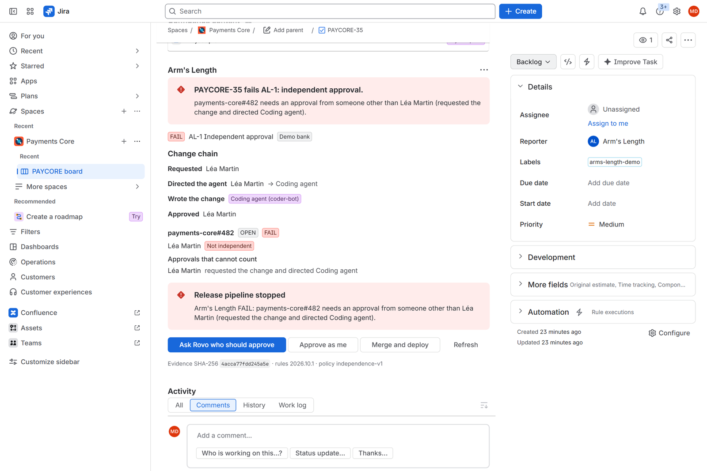
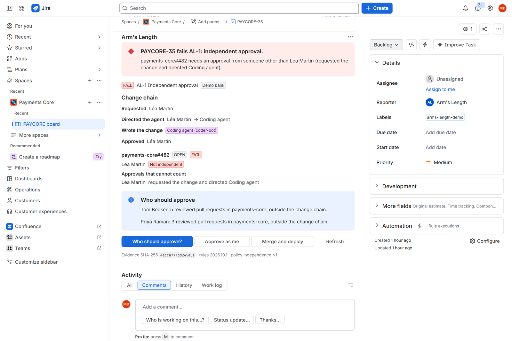
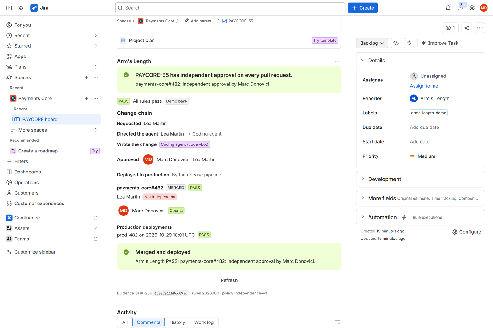
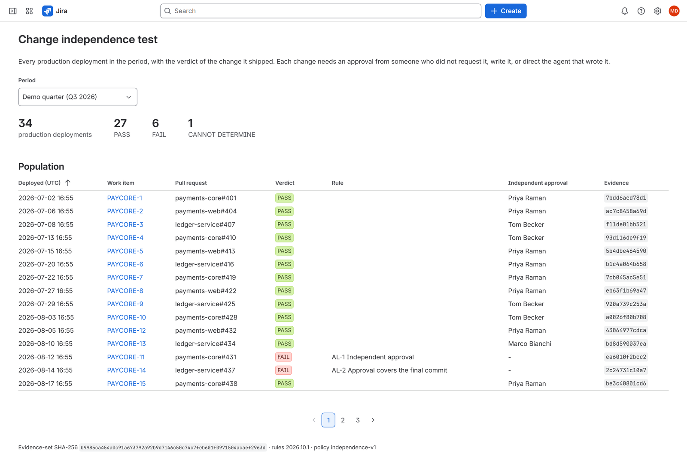
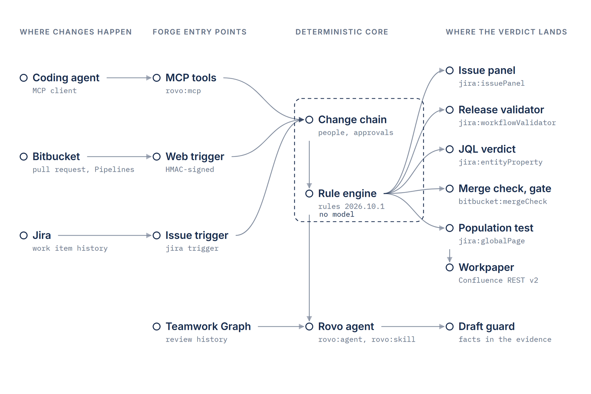
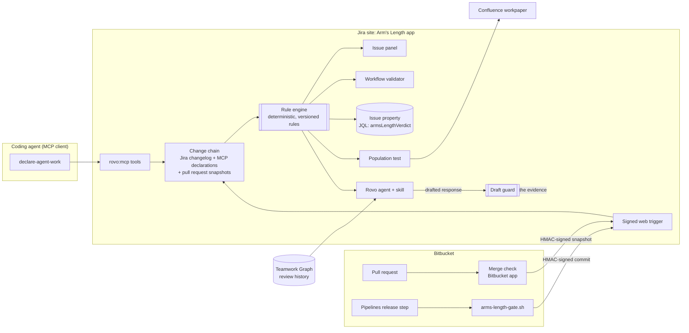
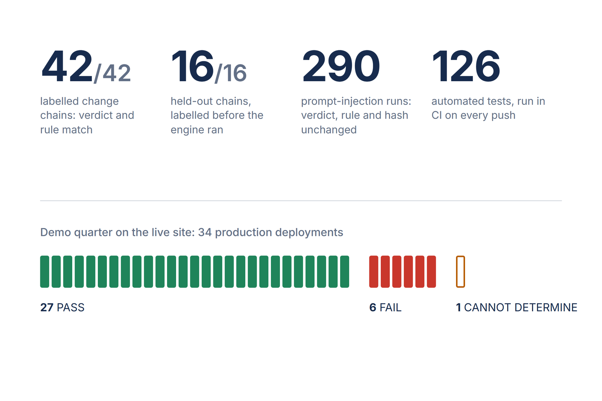
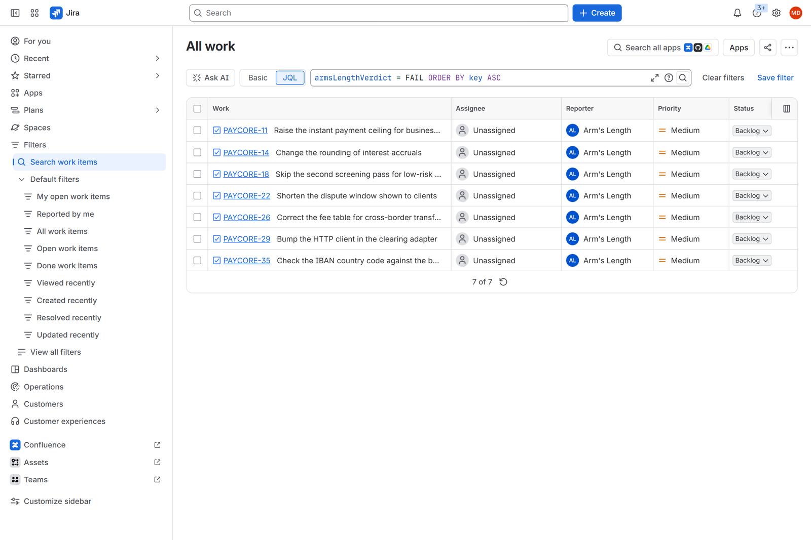

# Arm's Length: independent approval for agent-written code



    

**Arm's Length finds the person behind every agent-written change and checks that someone else approved it, for
the engineer approving a pull request and the auditor testing change controls at quarter end.**

I test change-management controls in IT audits at a bank's technology practice.

| | |
|---|---|
| Track | Apps for Software Teams |
| Bonus prizes | Best app with Atlassian MCP, Best Agents, Best Teamwork Graph integration |
| Built with | Forge (UI Kit, KVS, web trigger, workflow validator, entity properties), Jira, Bitbucket, Confluence, Rovo agent, action and skill modules, `rovo:mcp`, Teamwork Graph API, Bitbucket Pipelines |
| Headline result | 42 of 42 labelled change chains and 16 of 16 held-out chains get the labelled verdict and rule; the demo quarter's 34 production deployments yield 27 PASS, 6 FAIL, 1 CANNOT DETERMINE |

## For judges

| Criterion | Where to look |
|---|---|
| Technological implementation | [`manifest.yml`](manifest.yml) and [`bitbucket/manifest.yml`](bitbucket/manifest.yml) (21 modules across Jira, Bitbucket, Rovo and MCP, plus the Confluence and Teamwork Graph APIs), [`src/forge/`](src/forge), [`tests/forge.test.ts`](tests/forge.test.ts) |
| Design | [The issue panel](src/frontend/panel.tsx), [the population test](src/frontend/population.tsx), [the settings](src/frontend/admin.tsx), [the judge path](#see-it-work) |
| Potential impact | [The problem](#the-problem), [the rule table](src/core/rules.ts) with its regulatory references |
| Innovation | [The MCP caller's identity is the evidence](#the-mcp-call-is-the-evidence) |
| Presentation | [How it works](#how-it-works), [Evidence](#evidence) |

## See it work

The judge path needs one Jira site and no Bitbucket account.

1. Install the app with the installation link. Open **Apps > Change independence test** and click
   **Open the settings** (or **Settings > Marketplace apps > Arm's Length**).
2. Pick a project and click **Load demo bank**. It creates 35 work items with one quarter of synthetic change
   chains: seven people, three coding agents, pull requests and production deployments.
3. Back on **Apps > Change independence test**, the demo quarter shows six FAIL rows and one CANNOT DETERMINE
   among 34 production deployments.
4. Open the scene the settings page links to, "Check the IBAN country code against the beneficiary bank", and
   open **Arm's Length** from the work item's apps button. Its only approval comes from Léa Martin, who
   requested the change and assigned it to the Coding agent. The panel shows FAIL and names who cannot approve.
5. Click **Merge and deploy**: the release pipeline check stops it. Click **Ask Rovo who should approve**: the
   agent names Tom Becker, who reviewed 5 pull requests in `payments-core` in 90 days and is outside the chain.
6. Click **Approve as me**. You are outside the chain, so the verdict turns PASS. **Merge and deploy** now ships it.
7. Back on the population page, **Publish workpaper** writes the quarter's test to Confluence.
8. To play the scene again, click **Reset the scene** in the settings.

| The scene fails | An outside approval ships it | The quarter, tested |
|---|---|---|
|  |  |  |

With no Atlassian account at all: `npm ci && npm run demo` runs the same scene and population test on the
same rule engine.

## The problem

At 17:40 a payments team lead assigns PAY-482 to a coding agent. At 18:05 the agent's service account opens the
pull request. At 18:12 the same lead approves it. Every system shows two names, a bot and a person, so every
four-eyes report passes. One person decided alone.

- **Regulation asks for independence.** Commission Delegated Regulation (EU) 2024/1774, Article 17, requires
  "mechanisms to ensure the independence of the functions that approve changes". PCI DSS v4.0.1 requirement
  6.2.3.1 requires code changes to be "Reviewed by individuals other than the originating code author".
- **Agents are now authors.** Claude Agent for Jira has 10,332 installs and GitHub Copilot for Jira 3,698
  (Atlassian Marketplace, 28 Oct 2026). Both open pull requests from service accounts.
- **Approval tools count names, not independence.** A bot as author and its principal as approver satisfy every
  "two different accounts" rule.

Arm's Length is for the engineer who approves a pull request an agent wrote, and for the IT risk officer or
internal auditor who tests change management at quarter end.

## How it works





**Deterministic boundary.** Every verdict comes from the rule engine in [`src/core/`](src/core): pure TypeScript,
no model, a versioned rule table with a regulatory reference on each rule. The Rovo agent explains verdicts,
proposes reviewers from the tools' results and drafts management responses; [the guard](src/core/guard.ts)
rejects any draft that names a person, number, date, time or work item absent from the evidence.

**The change chain.** For each pull request the engine computes the conflicted set:

- the **requester** (the work item's reporter);
- the **implementers** (every author of a commit or of the pull request);
- the **principals**: whoever directed an agent whose work is in the change, by assigning it the work item, by
  owning the automation rule that did, or by declaring the work over MCP.

An approval counts when it comes from a person outside that set, on the final commit, before the merge (or
within the emergency window after it, for a declared emergency change).

**Verdicts.** PASS, FAIL, or CANNOT DETERMINE when evidence is missing (no Jira history, an agent with no known
principal, no linked pull request). Gates treat CANNOT DETERMINE as not passing.

### The MCP call is the evidence

A Forge action reads the caller's account from the invocation context, never from its inputs. When a coding
agent calls `declare-agent-work` through the app's MCP server, the identity on the call is the developer who
runs the agent. Arm's Length records that person as the principal of the branch, so the merge check knows whose
approval does not count. The agent declares its own principal, and a prompt cannot forge it: the test
[`records the caller as principal, whatever the inputs say`](tests/forge.test.ts) passes a different account in
every input field.

[`agent-skills/arms-length/SKILL.md`](agent-skills/arms-length/SKILL.md) is the open-source skill a third-party
coding agent loads to call these tools before it opens a pull request.

## How Atlassian is used

| Product or module | What it does here |
|---|---|
| `jira:issuePanel` | The change chain, the verdict, who cannot approve, and the demo actions |
| `jira:globalPage` | The population test: every production deployment in a period, exceptions to work items, the workpaper |
| `jira:adminPage` | Pairing, identity registry (bots, automation owners), policy, release gate log, demo bank |
| `jira:workflowValidator` | Blocks the release transition until the verdict is PASS |
| `jira:entityProperty` | Indexes the verdict, so `armsLengthVerdict = FAIL` works in JQL |
| `trigger` | Re-evaluates when the assignee, labels or reporter change |
| `webtrigger` | HMAC-signed endpoint for the Bitbucket app and the Pipelines gate |
| `rovo:mcp` | `declare-agent-work`, `who-must-approve`, `change-evidence` for external MCP clients |
| `rovo:agent`, `action`, `rovo:skill` | The Arm's Length agent, five actions, and the independence policy as a skill |
| `devops:developmentInfoProvider`, `devops:deploymentInfoProvider` | The demo bank's pull requests and deployments in Jira's development panel |
| Teamwork Graph API | Review history (who reviewed which pull requests) for reviewer suggestions, from a persisted Cypher query the app owns, run as the user with `customQuery` |
| Confluence REST v2 | The workpaper page, created in the auditor's name |
| `bitbucket:mergeCheck` | Sends each pull request's authors, approvals and pushes for a verdict, and shows it on the pull request |
| `bitbucket:repoPullRequestCard`, `bitbucket:workspaceSettingsMenuPage` | The verdict on the pull request page; pairing |
| Bitbucket Pipelines | [`pipelines/arms-length-gate.sh`](pipelines/arms-length-gate.sh) fails the deployment step unless the commit's work items PASS |
| Forge KVS and secret store | Declarations, pull request snapshots, deployments, the pairing secret |

On Bitbucket's Free plan a custom merge check informs but cannot block a merge. The release is blocked in two
places that work on every plan: the Jira validator and the Pipelines step.

## What it will not do

- It never approves, merges or deploys. The Rovo agent has no action that changes a verdict or a policy.
- It ignores pull request titles, descriptions, comments and commit messages when it decides. They are not part
  of the evidence the verdict hash covers.
- It refuses a `declare-agent-work` call that carries no user identity.
- It posts a management response only when the guard finds every fact in the evidence.
- The web trigger rejects unsigned requests, wrong signatures and timestamps older than five minutes.

## Evidence



| What | Result | Reproduce |
|---|---|---|
| Labelled change chains, written before the rules ([`eval/cases`](eval/cases)) | 42 of 42 verdicts and primary rules match | `npm run eval` |
| Held-out chains, labelled before the engine ran | 16 of 16 match | `npm run eval` |
| Free-text injection (5 payloads into every title, description, comment and commit message of 58 chains) | Verdict, rule and evidence hash unchanged | `npx vitest run tests/attack.test.ts` |
| Reordering reviews, assignments and deployments (20 rounds) and renaming every person | Unchanged | same |
| Adding one independent, current approval to each AL-1 failure | All turn PASS | same |
| Removing the counted approvals from each PASS, or pushing a later commit | All turn FAIL (AL-2 for the push) | same |
| Bitbucket snapshot to verdict to release gate, through the signed web trigger | FAIL, then PASS after an independent approval; unseen commits blocked | `npx vitest run tests/forge.test.ts` |
| The shell gate's signature verified by the app's verifier | Accepted; wrong secret refused | `npx vitest run tests/gate.test.ts` |
| Pairing endpoint pasted into the Bitbucket app | Only Forge web trigger hosts accepted, over HTTPS, without credentials or ports | `npx vitest run tests/core.test.ts` |
| Demo quarter population test | 34 deployments: 27 PASS, 6 FAIL, 1 CANNOT DETERMINE, evidence-set hash stable across builds | `npm run demo` |

The confusion matrices are in [`eval/reports/confusion.md`](eval/reports/confusion.md).

### Run live

On a Jira and Confluence Standard developer site, signed in as a site admin outside the demo chains. Times are
wall-clock in the browser. Rows dated 29 October 2026 ran on the production environment; the MCP rows ran on
28 October 2026 on the development environment, whose tool names carry a `_development` suffix.

| Step | Result |
|---|---|
| Load demo bank (29 Oct) | 35 work items created, change chains stored, pull requests and deployments in Jira's development panel, 21.8 s |
| Population test, demo quarter (29 Oct) | 34 production deployments: 27 PASS, 6 FAIL, 1 CANNOT DETERMINE, 4.2 s |
| JQL `armsLengthVerdict = FAIL` (29 Oct) | 7 work items: the 6 failures of the quarter and the open scene |
| **Merge and deploy** on the scene (29 Oct) | Stopped in 0.8 s: "needs an approval from someone other than Léa Martin" |
| Transition to Ready for release, validator (29 Oct) | Refused in 2.4 s with the same reason |
| **Approve as me**, then **Merge and deploy** (29 Oct) | Verdict PASS, pull request merged, `prod-482` deployed, 1.3 s |
| Raise exceptions as work items (29 Oct) | 7 work items, 8.5 s |
| Publish workpaper (29 Oct) | Confluence page in the signed-in user's name, full width, 2.9 s |
| **Reset the scene** (29 Oct) | Pull request open again, verdict FAIL, deployment removed, 1.3 s |
| MCP client (OAuth 2.1 with PKCE, Streamable HTTP) to `mcp.atlassian.com/forge/<appId>` (28 Oct) | `initialize` 115 ms, `tools/list` 334 ms: the three tools |
| `declare-agent-work` over MCP on a new work item (28 Oct) | Recorded the signed-in developer's account as principal, 3.7 s |
| `who-must-approve` over MCP on the scene (28 Oct) | Léa Martin's approval does not count; proposes Tom Becker (5 reviews in `payments-core`), 2.4 s |
| `change-evidence` over MCP on a work item with no pull request (28 Oct) | CANNOT DETERMINE under AL-8, with the evidence hash, 2.7 s |
| Docker, `--network none` (28 Oct) | Image built in 66 s; the demo prints the same quarter and evidence-set hash |



**Real and synthetic.** The case sets and the demo bank are synthetic. The engine, the adapters and the Forge
modules are the code that runs on a Jira site.

## Claims

| Claim | Code | Test |
|---|---|---|
| The principal comes from the caller's identity | [`src/forge/actions.ts`](src/forge/actions.ts) `callerOf` | `tests/forge.test.ts` "records the caller as principal" |
| Free text cannot change a verdict | [`src/core/evidence.ts`](src/core/evidence.ts) `decisionEvidence` | `tests/attack.test.ts` "free text never changes a verdict" |
| Stale approvals do not count | [`src/core/evaluate.ts`](src/core/evaluate.ts) | `tests/attack.test.ts` "a commit pushed after the approvals" |
| Missing evidence fails closed | [`src/core/evaluate.ts`](src/core/evaluate.ts), [`src/forge/validator.ts`](src/forge/validator.ts) | `tests/attack.test.ts` "losing the repository history"; `tests/forge.test.ts` "blocks when the work item cannot be read" |
| Drafts may cite only the evidence | [`src/core/guard.ts`](src/core/guard.ts) | `tests/core.test.ts` "draft guard"; `tests/forge.test.ts` "management responses" |
| Signed requests only | [`src/core/signature.ts`](src/core/signature.ts), [`src/forge/webtrigger.ts`](src/forge/webtrigger.ts) | `tests/forge.test.ts` "rejects unsigned, forged and replayed requests" |
| Every rule cites a regulation | [`src/core/rules.ts`](src/core/rules.ts) | `tests/evaluate.test.ts` "every rule carries at least one regulatory reference" |
| Review history comes from the app's persisted Teamwork Graph query, page by page | [`src/forge/graph.ts`](src/forge/graph.ts) | `tests/graph.test.ts` "pages through the persisted query" |
| The workpaper escapes markup | [`src/core/workpaper.ts`](src/core/workpaper.ts) | `tests/core.test.ts` "escapes markup in the workpaper" |
| The Bitbucket app sends snapshots only to a Forge web trigger | [`src/core/signature.ts`](src/core/signature.ts) `isWebTriggerUrl`, [`bitbucket/manifest.yml`](bitbucket/manifest.yml) egress | `tests/core.test.ts` "pairing endpoint" |
| The scene can be played again | [`src/forge/demo.ts`](src/forge/demo.ts) `resetDemoScene` | `tests/demo-flow.test.ts` "resets the scene after it shipped" |

## Quickstart

No credentials:

```
npm ci
npm test          # 126 tests
npm run eval      # case-set scores
npm run demo      # the PAY-482 scene and the quarter's population test
npm run manifest  # validates both Forge manifests offline
```

Gate a new project's release transition (company-managed, no work items yet):

```
JIRA_SITE=<site>.atlassian.net JIRA_EMAIL=<email> JIRA_API_TOKEN=<token> npm run release-gate -- PAY
```

Or `docker build -t arms-length . && docker run --rm arms-length`.

On a Jira site ([`docs/setup.md`](docs/setup.md) has every step):

```
npm install -g @forge/cli
forge login
forge register        # once, writes the app ID into manifest.yml
forge deploy
forge install --product jira --site <your-site>.atlassian.net
```

## Layout

```
src/core/        rule engine, evidence hash, explanations, population test, workpaper, draft guard
src/adapters/    Jira changelog and Bitbucket activity to change chains
src/forge/       Forge handlers: resolvers, web trigger, validator, actions, demo bank loader
src/frontend/    UI Kit: issue panel, population test, settings
bitbucket/       the Bitbucket app: merge check, pull request card, pairing page
pipelines/       the release gate step and an example pipeline
skills/          the Rovo skill; agent-skills/ the skill for MCP coding agents
eval/            labelled and held-out change chains, the scorer, the report
```

## Licence

MIT, see [LICENSE](LICENSE).
